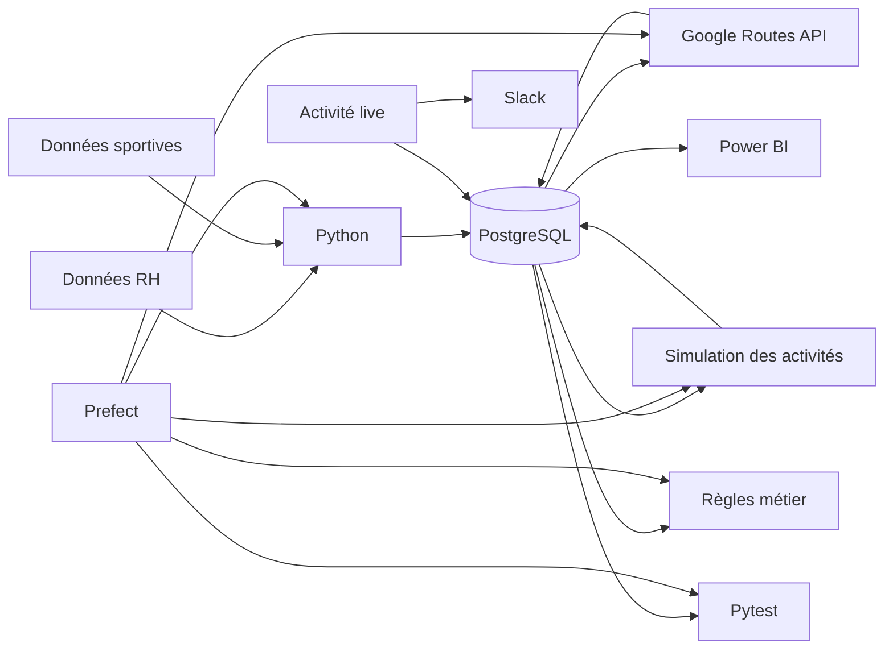

# POC avantages sportifs · Option B

> Une chaîne simple et traçable, des données RH jusqu’au reporting. ✿

Ce projet est un proof of concept réalisé pour **Sport Data Solution**.
L’objectif est de vérifier qu’il est possible de calculer automatiquement des avantages liés à la pratique sportive des salariés, tout en gardant un pipeline rejouable et contrôlé.

## Ce que fait le POC

Le projet couvre deux avantages :

- une prime correspondant à **5 % du salaire annuel brut** pour les salariés venant au bureau avec un mode de déplacement sportif validé ;
- **5 journées bien-être** pour les salariés ayant réalisé au moins **15 activités physiques sur l’année**.

Le taux de prime et les seuils sont enregistrés comme paramètres afin de pouvoir les modifier sans changer les règles dans le code.

## Chemin des données



## Outils utilisés

| Besoin | Outil |
|---|---|
| Traitements et ETL | Python |
| Stockage | PostgreSQL |
| Environnement de base de données | Docker |
| Validation des trajets | Google Routes API |
| Orchestration et monitoring | Prefect |
| Tests qualité | pytest |
| Notifications live | Slack Incoming Webhook |
| Reporting | Power BI |
| Versionnement | Git / GitHub |

## Données et règles principales

Les deux fichiers sources contiennent **161 salariés**.

Après nettoyage :

- 161 salariés présents dans les deux sources ;
- 95 salariés avec une pratique sportive renseignée ;
- 2 434 activités simulées sur les 12 derniers mois ;
- les activités ajoutées pendant les tests live sont conservées avec `source = live`.

Validation des déplacements :

- marche / running : maximum **15 km** ;
- vélo / trottinette / autres : maximum **25 km**.

Les distances domicile-entreprise sont calculées avec Google Routes API.

## Lancer le projet

Depuis PowerShell :

```powershell
cd D:\Portfolio_Hassna\05_Sport_Data_Infrastructure
.\.venv\Scripts\Activate.ps1
docker compose up -d
```

### Terminal 1 · Prefect

```powershell
prefect server start
```

L’interface de monitoring est disponible sur :

```text
http://127.0.0.1:4200
```

### Terminal 2 · Pipeline automatisé

```powershell
cd D:\Portfolio_Hassna\05_Sport_Data_Infrastructure
.\.venv\Scripts\Activate.ps1
python orchestration\serve_pipeline.py
```

Le déploiement :

```text
sport-data-pipeline/daily-sport-data-pipeline
```

est planifié toutes les **24 heures**, tant que le service Prefect est actif.

Pour vérifier le déploiement :

```powershell
prefect deployment ls
```

Pour déclencher immédiatement une exécution :

```powershell
prefect deployment run "sport-data-pipeline/daily-sport-data-pipeline"
```

Le pipeline exécute successivement :

```text
initialisation PostgreSQL
→ audit
→ nettoyage
→ chargement PostgreSQL
→ validation des trajets
→ génération des activités
→ règles métier
→ tests qualité
→ monitoring
```

Un lancement manuel reste également possible avec :

```powershell
python orchestration\pipeline.py
```

## Qualité

Les contrôles sont regroupés dans :

```text
tests/test_data_quality.py
```

Ils vérifient notamment :

- les identifiants salariés ;
- les salaires ;
- les distances ;
- les dates des activités ;
- la cohérence des salariés référencés ;
- le volume de l’historique ;
- les règles de prime ;
- les règles des journées bien-être.

Résultat actuel :

```text
10 tests passés
```

## Démonstration live

### Modifier le taux de prime

```powershell
python src\update_bonus_rate.py
```

Le script demande :

```text
Nouveau taux de prime en % :
```

Exemple pour la démonstration :

```text
5 % → 8 %
```

Après actualisation de Power BI, le coût total des primes est recalculé.

À la fin du test, remettre :

```text
5 %
```

### Ajouter une nouvelle course

```powershell
python src\add_live_activity.py --employee-id 17027 --sport Running --distance 5200 --duration 30 --comment "Course live du POC"
```

Cette action :

```text
ajoute l'activité dans PostgreSQL
→ l'identifie comme live
→ envoie automatiquement le message Slack
→ rend l'activité visible dans Power BI après actualisation
```

Dans Power BI, le filtre `source` permet d’afficher directement les activités `live`.

## Reporting Power BI

Le fichier Power BI présente :

- coût total des primes ;
- salariés éligibles à la prime ;
- activités sportives ;
- salariés éligibles aux journées bien-être ;
- nombre total de journées bien-être ;
- activités par sport ;
- détail des activités ;
- distinction entre données `simulated` et `live`.

Le reporting est actualisable après une modification du taux ou l’ajout d’une nouvelle activité.

## Sécurité

Les données RH et les secrets ne sont pas stockés dans Git. Les fichiers sources fournis pour la mission restent localement dans `data/raw/` et sont exclus du dépôt.

Le fichier `.env` contient localement :

```text
connexion PostgreSQL
clé Google Maps
webhook Slack
```

Il est exclu du versionnement.

Le dépôt contient uniquement `.env.example`, sans valeur sensible.

## Résultat actuel

Le POC permet aujourd’hui de :

```text
charger et contrôler les données
→ calculer les avantages
→ automatiser et surveiller le pipeline avec Prefect
→ modifier les paramètres métier
→ injecter une activité live
→ publier cette activité dans Slack
→ actualiser les résultats dans Power BI
```
